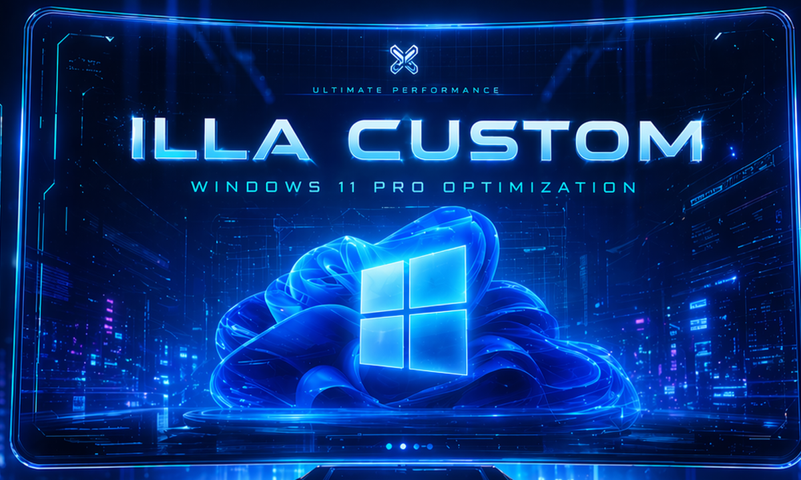

  <h1>Привіт, я Illia Syniuk 👋</h1>
  
<strong>Студент ІКТ · Розробник програмного забезпечення · Розробник ігор · Креативний технічний фахівець</strong>

  
Створюю практичне програмне забезпечення, корисні інструменти й творчі цифрові проєкти. Близько 8 років самостійного навчання та програмування в межах проєктів.

  
<a href="README.md">English</a> · <a href="README.nl.md">Nederlands</a> · <a href="README.uk.md"><strong>Українська</strong></a>

  
<a href="https://github.com/Illa777">GitHub</a> · <a href="https://bot-urtana.netlify.app/">Discord-бот Urtana</a>

---

## Про мене

Я навчаюся на програмі **ICT Medewerker** у **Koning Willem I College** та самостійно розробляю програмне забезпечення. Мене цікавлять розробка ПЗ, ІТ-підтримка, створення ігор і зручні цифрові продукти. Мені подобається розбиратися, як працюють системи, послідовно розв’язувати проблеми й перетворювати ідеї на робочі рішення. Паралельно з навчанням я працюю в **Action**.

Я працював над вебзастосунками, настільними інструментами, системами на базі даних та інтерактивними іграми. Одним із моїх особистих досягнень став продаж власного ігрового проєкту.

## Проєкти

### Програмне забезпечення для роботи й продуктивності

- **[NetWerk-Magazijn](https://github.com/Illa777/NetWerk-Magazijn)** — Багатомовний локальний вебзастосунок для обліку кабельних запасів, видачі й повернення, роботи зі сканером, історії змін, імпорту/експорту Excel і керування ролями. Створений на Flask і SQLite; передбачено процес збирання Windows-EXE.
- **LabelAtelier** — Настільна програма для Windows для створення й друку товарних етикеток Code 128, списків сканування та каталогів товарів. Має попередній перегляд PDF/PNG, повторно використовувані шаблони й інтерфейс нідерландською, українською та англійською.
- **Repair & Service Database Client** — Вебзастосунок для навчального стажування: реєстрація ремонту ноутбуків і керування клієнтами, пристроями, статусами ремонту та сервісними записами. Створений на PHP, MySQL, HTML, CSS і JavaScript.
- **Система динамічного обліку запасів** — Настільний інструмент на Python для керування товарами й запасами з локальним збереженням даних та журналом історії/операцій. Технології: SQLite, Tkinter/PyQt і PyInstaller.

### Творчі й особисті проєкти

- **Pick Me! — візуальна новела** — Ігровий проєкт на Ren’Py для мобільних пристроїв: розвиток персонажів, розгалужені вибори й власний інтерфейс.
- **Windows 11 Pro — Illa Custom** *(у розробці)* — Проєкт налаштування й оптимізації Windows 11 Pro. Супутній вебсайт також розробляється. Додане зображення — концепт-арт, а не результат тестування продуктивності.

  

- **[Urtana — Discord-бот](https://bot-urtana.netlify.app/)** — Мій проєкт Discord-бота та його публічний вебсайт.
- **Сайт-портфоліо та CV** — Адаптивний персональний сайт із моєю інформацією, освітою, навичками та вибраними проєктами.

## Освіта

| Період | Програма | Заклад / місце | Статус |
| :--- | :--- | :--- | :--- |
| 2025–дотепер | ICT Medewerker | Koning Willem I College, Вегел | Навчаюся |
| 2022–2023 | Металеві та електротехнічні монтажні роботи | Koning Willem I College, Осс | Диплом отримано |
| 2020–2022 | ISK (підготовчий перехідний клас) | Koning Willem I College | Сертифікат отримано |
| 2017–2018 | Курс програмування та робототехніки (основи C++ і Java) | Україна | Завершено |
| 2015–2023 | Середня школа, математичний напрям (класи 5–11) | Україна | Завершено |
| 2011–2015 | Початкова школа (класи 1–4) | Україна | Завершено |

## Технології

- **Програмування:** Python, C#, C++, Java, JavaScript, PHP
- **Веб:** HTML, CSS
- **Бази даних:** MySQL, SQLite
- **Настільні програми та ігри:** Tkinter, PyQt, Unity, Ren’Py
- **Креативні інструменти:** Blender, Photoshop, After Effects
- **Робочий процес:** Git, GitHub, PyInstaller

## Мови

- Українська — рідна
- Російська — вільне володіння
- Нідерландська — B2
- Англійська — B1

## Поточні цілі

Прагну розвиватися як ІТ-фахівець, здобувати більше практичного досвіду та створювати складніші програмні проєкти. У перспективі хочу заснувати власну ігрову студію — **Studio Setlies Games**.

---

*Постійно навчаюся, створюю й розвиваюся. 🚀*
